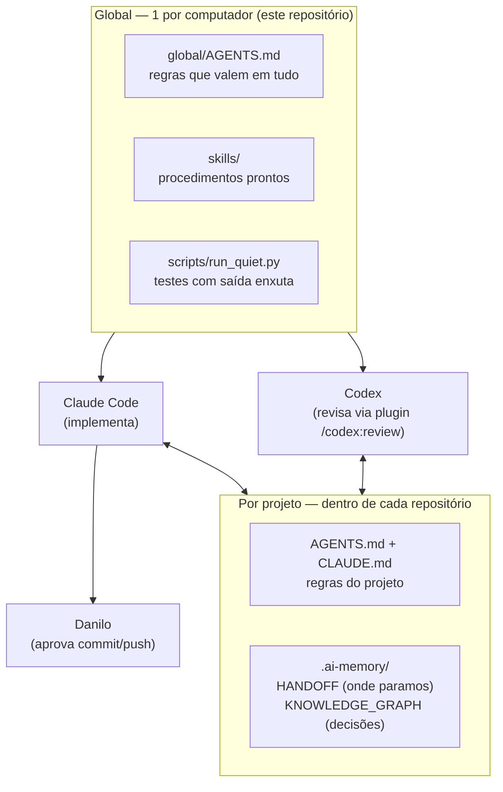

# agentes-config — o "cérebro" dos meus agentes de IA

Regras, skills e scripts que fazem **Claude Code** e **Codex** trabalharem do mesmo jeito em
todos os meus projetos, sem perder contexto e sem mexer no que não devem.
Inspirado no repositório do Vitor Góngora, adaptado: sem acesso total à máquina, sem API paga,
com aprovação humana para todo commit e push.

## Como funciona



| Onde | Arquivo | Para quê |
|---|---|---|
| Global | `global/AGENTS.md` | Regras de tudo: Git com aprovação, segredos, testes, anti-alucinação |
| Global | `skills/*/SKILL.md` | Receitas: iniciar tarefa, rodar testes, revisão do Codex, encerrar sessão, auditoria de arquitetura, preparar PR |
| Global | `scripts/run_quiet.py` | Roda testes e mostra só o resumo ou o erro |
| Global | `global/claude-settings.json` | **Trava técnica**: Claude Code sempre pede confirmação para commit, push, merge, PR e deploy (mesmo em auto mode); bloqueia force push e leitura de `.env` |
| Projeto | `AGENTS.md` | O que é específico daquele projeto (stack, riscos, comandos) |
| Projeto | `CLAUDE.md` | Faz o Claude Code ler o `AGENTS.md` |
| Projeto | `.ai-memory/HANDOFF.md` | Onde a última IA parou (≤ 15 linhas) |
| Projeto | `.ai-memory/KNOWLEDGE_GRAPH.md` | Decisões e lições, 1 linha cada |

Projetos que já usam `docs/PROJECT_STATUS.md` continuam com ele no papel do HANDOFF.

## Instalar (1 vez por computador, no WSL/Linux/Mac)

```bash
git clone https://github.com/daniloptoledo/agentes-config.git ~/projetos/agentes-config
cd ~/projetos/agentes-config
./install.sh
```

O que ele faz: aplica as travas em `~/.claude/settings.json` (com backup, sem apagar o que existe) e cria links de `~/.claude/CLAUDE.md`, `~/.codex/AGENTS.md`, `~/.claude/skills/*` e
`~/.agentes` para este repositório. Arquivos antigos viram `.backup-<data>`.

**Como verificar:** `ls -l ~/.claude/CLAUDE.md` aponta para este repositório e
`python3 ~/.agentes/scripts/run_quiet.py python3 --version` mostra `[PASS]`.

**Atualizar:** `git pull` neste repositório. Os links já apontam para cá.

## Preparar um projeto

```bash
~/projetos/agentes-config/init-projeto.sh /caminho/do/projeto
```

Cria `AGENTS.md`, `CLAUDE.md` e `.ai-memory/` e acrescenta linhas no `.gitignore`.
**Nunca sobrescreve** o que já existe e **não faz commit**.

## Codex dentro do Claude Code (1 vez por máquina)

No Claude Code, um comando por vez:
```
/plugin marketplace add openai/codex-plugin-cc
/plugin install codex@openai-codex      (escolher: user scope)
/reload-plugins
/codex:setup                            (deve mostrar ready: true)
```
Revisão sob demanda: `/codex:review`. Não ligar o `--enable-review-gate` (gasta cota em toda sessão).

## Prompts do dia a dia

**Abrir uma sessão:**
```text
Use a skill iniciar-tarefa. Me diga em 3 linhas onde paramos e proponha o próximo passo.
```

**Implementar com revisão:**
```text
Implemente <tarefa> em passos pequenos. Rode os testes com a skill rodar-testes e,
antes de terminar, use a skill revisao-codex. Não commite.
```

**Fechar a sessão:**
```text
Use a skill encerrar-sessao.
```

## O que ficou de fora do repositório do Vitor (e por quê)

| Item dele | Decisão |
|---|---|
| Servidor MCP próprio chamando Codex com `danger-full-access` | Fora: dá acesso total ao computador; o Codex entra pelo plugin oficial da OpenAI (`openai/codex-plugin-cc`) |
| Modelos locais 32B (Ollama) | Fora por enquanto: hardware dele é outro e ele mesmo desaconselhou o Ollama |
| Auto-fix no CI com API paga | Fora: custo e commit sem revisão |
| REPO_MAP gerado por script | Depois, quando algum projeto tiver dezenas de arquivos |
| Motor de UI/UX | Fora: não é o foco agora |
